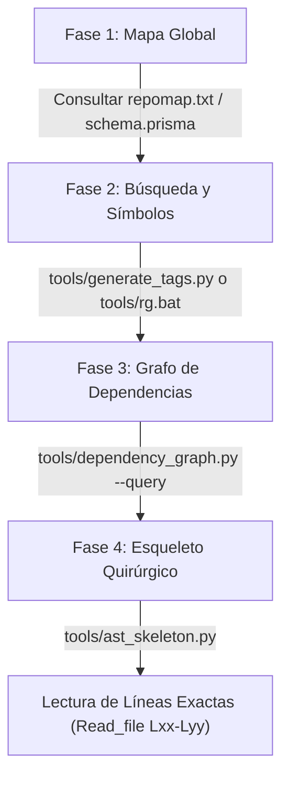

# Inteligencia de Código y Optimización de Tokens (Code Intelligence Skill)

> **Directorio de Referencia:** `tools/`, `prisma/` y `skills/code_intelligence_skill.md`
> *Herramientas integradas localmente para permitir que los agentes naveguen con precisión milimétrica y un ahorro de hasta 85% en tokens de contexto.*

---

## 🎯 PROPÓSITO

Project Saavedra es un monolito extenso con más de 72 controladores, 146 modelos Eloquent, 147 tablas en base de datos y cientos de vistas Blade y scripts JavaScript.
Leer archivos completos de 2,000 líneas a ciegas para localizar una variable o un método satura la ventana de contexto del modelo, degrada la capacidad de razonamiento y multiplica los costos.

Esta habilidad le proporciona al agente un conjunto de **10 herramientas locales de alta velocidad** inspiradas en los estándares de Claude Code y Aider para entender el grafo del proyecto, extraer esqueletos sintácticos y consultar conexiones en milisegundos.

---

## 🔄 PROTOCOLO DE NAVEGACIÓN EN 4 FASES (CERO DESPERDICIO DE TOKENS)

Antes de abrir o volcar cualquier archivo fuente completo en el contexto del chat, el agente DEBE seguir esta secuencia:



1. **Fase 1 — Ubicación y Modelo Mental (Global):**
   - Para entender la arquitectura global en ~1,400 tokens, lee [repomap.txt](file:///c:/Users/Jaxer020406/Documents/GitHub/Project_saavedra/repomap.txt).
   - Para conocer las tablas y columnas sin leer 31 migraciones, consulta [prisma/schema.prisma](file:///c:/Users/Jaxer020406/Documents/GitHub/Project_saavedra/prisma/schema.prisma).

2. **Fase 2 — Localización Exacta de Símbolos:**
   - Para saber exactamente dónde se declaró una función, clase o método:
     ```powershell
     python tools/generate_tags.py --search <nombre_funcion>
     ```
   - Para búsquedas textuales instantáneas en todo el proyecto a velocidad de Rust nativo:
     ```powershell
     .\tools\rg.bat "termino_o_variable" app/
     ```

3. **Fase 3 — Análisis de Impacto en el Grafo (NetworkX):**
   - Antes de modificar un modelo o controlador, pregunta al grafo quién depende de él:
     ```powershell
     python tools/dependency_graph.py --query <NombreModeloOControlador>
     ```

4. **Fase 4 — Inspección Quirúrgica (AST Tree-sitter):**
   - En lugar de leer un archivo de 2,000 líneas, extrae su esqueleto estructural:
     ```powershell
     python tools/ast_skeleton.py app/Http/Controllers/AlmacenFundicionController.php
     ```
   - El esqueleto te indicará las firmas de los métodos y sus líneas exactas (ej. `update() // L210-L245`).
   - Lee **únicamente** ese rango con `read_file(StartLine: 210, EndLine: 245)`.

---

## 🛠️ CATÁLOGO COMPLETO DE LAS 10 HERRAMIENTAS IMPLEMENTADAS

### 1. Tree-sitter (Análisis Sintáctico Estructural)
- **Script:** `tools/ast_skeleton.py`
- **Librerías instaladas:** `tree-sitter`, `tree-sitter-php`, `tree-sitter-javascript`, `tree-sitter-python`.
- **Qué hace:** Convierte código PHP o JS en un AST y extrae namespaces, `use`, clases, traits, interfaces y firmas completas de métodos con parámetros, tipos de retorno y números de línea exactos, suprimiendo el cuerpo de las funciones.
- **Ahorro:** **85% a 92% de tokens**.
- **Comando:**
  ```powershell
  python tools/ast_skeleton.py <ruta/al/archivo.php_o_js>
  ```

### 2. LLMLingua / Compresor Heurístico de Prompts y Logs
- **Script:** `tools/compress_context.py`
- **Qué hace:** Procesa logs verbosos de Laravel (`storage/logs/laravel.log`) o dumps masivos de código, colapsando decenas de líneas repetitivas de vendor framework (`vendor/laravel/...`), dejando únicamente el marco de la aplicación, el mensaje de error y la consulta SQL relevante.
- **Ahorro:** **50% a 70% de tokens** en depuración de errores.
- **Comando:**
  ```powershell
  python tools/compress_context.py storage/logs/laravel.log --log
  ```

### 3. Repomap (Algoritmo de Mapas de Repositorio estilo Aider)
- **Script:** `tools/repomap.py`
- **Artefacto persistente:** `repomap.txt`
- **Qué hace:** Construye un resumen arquitectónico ejecutivo del repositorio ordenado por PageRank (los hubs más interconectados del sistema: controladores principales, modelos más solicitados y prefijos de ruta).
- **Consumo:** Solo **~1,400 tokens** para tener el mapa mental del proyecto completo.
- **Comando:**
  ```powershell
  python tools/repomap.py --save
  ```

### 4. AST-grep (`sg`) (Búsqueda y Modificación Estructural)
- **Script / CLI:** `.\tools\sg.bat` (o `npx ast-grep`)
- **Paquete instalado:** `@ast-grep/cli` en `devDependencies` de `package.json`.
- **Qué hace:** Búsqueda sintáctica basada en el AST del código, permitiendo patrones lógicos como `function $NAME($$$ARGS)` o `$request->validate($$$)` sin los falsos positivos de regex.
- **Comando:**
  ```powershell
  .\tools\sg.bat run -p 'DB::beginTransaction()' app/Http/Controllers/
  ```

### 5. Universal Ctags (Indexador de Símbolos Instantáneo)
- **Script:** `tools/generate_tags.py`
- **Índice generado:** `tags` (compatible con formato Ctags estándar).
- **Qué hace:** Indexa más de 1,800 símbolos (clases, traits, métodos PHP, funciones JS) en milisegundos y permite búsquedas directas.
- **Comando:**
  ```powershell
  # Actualizar índice:
  python tools/generate_tags.py --build
  # Buscar un símbolo:
  python tools/generate_tags.py --search <nombre>
  ```

### 6. Ripgrep (`rg`) (Búsqueda Ultrarrápida por CLI)
- **Script / CLI:** `.\tools\rg.bat`
- **Binario nativo:** Ripgrep 15.0.0 compilado en Rust con soporte AVX2 y PCRE2.
- **Qué hace:** Filtra millones de líneas de código en milisegundos en local antes de decidir qué fragmento diminuto leer.
- **Comando:**
  ```powershell
  .\tools\rg.bat "gisToast" resources/js/
  .\tools\rg.bat -t php "where\(" app/Http/Controllers/
  ```

### 7. Git-Delta / Clean Diff (Optimizador de Diffs Atómicos)
- **Script:** `tools/clean_diff.py`
- **Qué hace:** Limpia la salida de `git diff`, forzando contexto mínimo unificado (`-U1`) y eliminando metadatos irrelevantes (`index 000..fff`), mostrando únicamente los hunks reales modificados.
- **Ahorro:** **60% a 75% de tokens** al auditar o validar cambios antes de commit.
- **Comando:**
  ```powershell
  python tools/clean_diff.py
  python tools/clean_diff.py --staged
  ```

### 8. NetworkX (Grafo de Dependencias del Proyecto)
- **Script:** `tools/dependency_graph.py`
- **Librería instalada:** `networkx`.
- **Qué hace:** Mapea el DAG completo de dependencias (368 nodos y 697 conexiones entre Rutas ↔ Controladores ↔ Modelos ↔ Vistas). Permite responder preguntas como: *"¿Si modifico el modelo Pieza, qué controladores y vistas se ven impactados?"*.
- **Comando:**
  ```powershell
  # Consulta de impacto:
  python tools/dependency_graph.py --query Pieza
  # Reconstruir grafo:
  python tools/dependency_graph.py --rebuild
  ```

### 9. Tiktoken (Contador de Presupuesto de Tokens)
- **Script:** `tools/count_tokens.py`
- **Librería instalada:** `tiktoken` (codificación `cl100k_base`).
- **Qué hace:** Mide el conteo exacto de tokens de archivos, directorios o fragmentos de texto antes de enviarlos al prompt o contexto.
- **Comando:**
  ```powershell
  # Analizar un archivo:
  python tools/count_tokens.py app/Http/Controllers/UserController.php
  # Top archivos más pesados de un directorio:
  python tools/count_tokens.py resources/views/ --top 10
  ```

### 10. Prisma Introspect (Esquema Unificado de Base de Datos)
- **Script generador:** `tools/introspect_schema.php`
- **Esquema generado:** [prisma/schema.prisma](file:///c:/Users/Jaxer020406/Documents/GitHub/Project_saavedra/prisma/schema.prisma)
- **Qué hace:** Introspecciona directamente las 147 tablas de MySQL usando la conexión activa de Laravel y produce un único archivo tipado con todas las tablas, columnas, tipos de datos, llaves primarias y restricciones.
- **Comando para regenerar:**
  ```powershell
  php tools/introspect_schema.php
  ```

---

## 📋 TABLA RESUMEN DE ATAJOS PARA EL AGENTE

| Necesidad / Pregunta | Herramienta Recomendada | Comando |
|---|---|---|
| "¿Qué archivos existen y cómo se conectan en general?" | **Repomap** | Leer `repomap.txt` |
| "¿Qué columnas tiene la tabla X?" | **Prisma Schema** | Buscar en `prisma/schema.prisma` |
| "¿Dónde está definida la función o método X?" | **Universal Ctags** | `python tools/generate_tags.py -s <nombre>` |
| "¿Dónde se usa el string o variable X?" | **Ripgrep** | `.\tools\rg.bat "<texto>" <carpeta>` |
| "¿Qué afecta modificar este modelo o controlador?" | **NetworkX Graph** | `python tools/dependency_graph.py -q <nombre>` |
| "¿Qué métodos tiene este controlador grande sin leerlo entero?" | **Tree-sitter AST** | `python tools/ast_skeleton.py <archivo.php>` |
| "¿Cuántos tokens me cuesta este archivo?" | **Tiktoken** | `python tools/count_tokens.py <archivo>` |
| "¿Qué error ocurrió en el log sin comerme 50 páginas?" | **LLMLingua Compressor** | `python tools/compress_context.py storage/logs/laravel.log --log` |
| "¿Cuáles son mis cambios atómicos de git?" | **Clean Git Diff** | `python tools/clean_diff.py` |
| "¿Dónde se usa esta estructura AST en el código?" | **AST-grep** | `.\tools\sg.bat run -p '<patron>' <ruta>` |

---

## 🛑 REGLAS DE ORO DE AHORRO DE TOKENS

1. **PROHIBIDO leer archivos de más de 500 líneas sin revisar primero su esqueleto AST:** Si vas a consultar un archivo como `almacen_fundicion.blade.php`, `WOController.php` o `almacen_fundicion.js`, ejecuta primero `python tools/ast_skeleton.py <archivo>` para obtener el número de línea exacto de lo que buscas.
2. **PROHIBIDO leer carpetas de migraciones completas:** Para conocer la estructura de tablas, lee directamente `prisma/schema.prisma`.
3. **Usa `tools/rg.bat` en vez de búsquedas ciegas:** Filtra siempre a nivel de archivo/carpeta antes de decidir qué leer.
4. **Comprueba el presupuesto con `tools/count_tokens.py`:** Si un payload supera los 3,000 tokens, comprímelo con `tools/compress_context.py` antes de inyectarlo.

